<div align="center">

<a href="https://git.io/typing-svg">
  
</a>

<br>

<a href="https://portfolio-ten-jade-6a9g43mlbv.vercel.app/"></a>
<a href="mailto:sashamelnik360@gmail.com"></a>
<a href="https://discord.com/users/imtiredwhenitalk"></a>

</div>

---

### /whoami

```shell
$ cat profile.txt
OS          : Fedora Linux
Education   : LNTU (Cybersecurity & Software Engineering)
Focus       : Full-Stack Web Development, API Security, Automation
Mindset     : Clean code, scalable architecture, security first
```
### /metrics & activity

<div align="center">
  <table>
    <tr>
      <td align="center" valign="top">
        
      </td>
      <td align="center" valign="top">
        
      </td>
    </tr>
  </table>
</div>

<div align="center" style="margin-top: 15px;">
  <a href="https://github.com/imtiredwhenitalk">
    <picture>
      <source media="(prefers-color-scheme: dark)" srcset="https://github.com/imtiredwhenitalk/imtiredwhenitalk/blob/output/github-contribution-grid-snake-dark.svg?raw=true">
      <source media="(prefers-color-scheme: light)" srcset="https://github.com/imtiredwhenitalk/imtiredwhenitalk/blob/output/github-contribution-grid-snake.svg?raw=true">
      
    </picture>
  </a>
</div>
